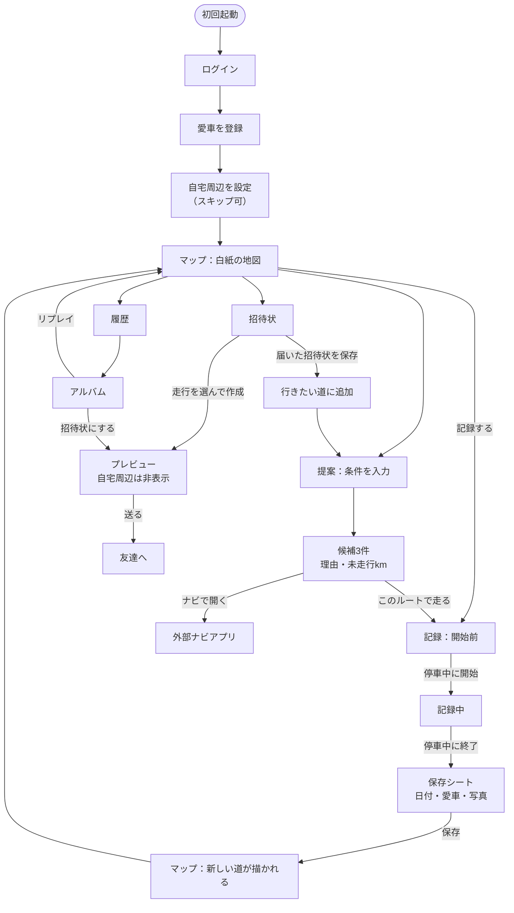
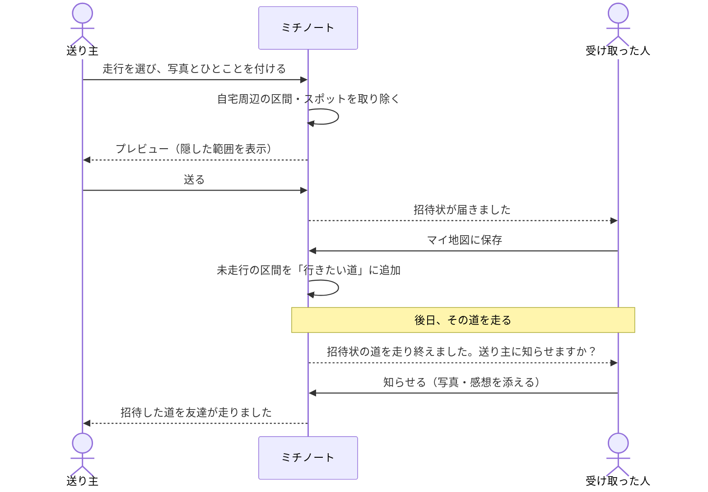

# 03 画面とフロー

試作品（`prototype/index.html`）の画面構成がそのまま土台です。下のタブは5つ。

| タブ | 画面 | 主な要素 |
|---|---|---|
| マップ | マイ地図 | 白地図／ナビ地図の切り替え、写真ピン、統計、地図が育つ再生 |
| 記録 | 記録前 → 記録中 → 保存 | 開始ボタン、現在地・距離・時間、立ち寄り登録、保存シート |
| 提案 | 条件入力 → 候補一覧 | 空き時間・気分・避けたい道、候補カード（理由付き） |
| 招待状 | 受信一覧／作成 | 届いた招待状、保存ボタン、作成フォームとプレビュー |
| 履歴 | 一覧 → アルバム | 愛車フィルター、走行カード、タイムライン、リプレイ |

ほかに、初回設定（ログイン → 愛車 → 自宅周辺）と設定画面（隠す範囲・公開範囲・通知・ブロック）があります。

## 全体の流れ

## 招待状のやりとり

## 画面設計のルール

- **走行中に操作させない。** 記録中の画面は大きな表示だけにし、細かい操作は停車中のみ。
- **地図を主役に。** 各画面の上半分は地図、下半分が操作パネル（試作品の構成）。
- **色の意味を固定する。** 緑＝走った道、オレンジ＝未走行・提案・行きたい道、赤＝記録中。
- **サンプルと本人のデータを混ぜない。** 例を表示するときは「サンプル」と明記する。
- **共有の前に必ずプレビュー。** 相手に何が見えるかを、送る前に本人が確認できる。

## デザインの方向性

スライドのトーン（深緑・オレンジ・生成り色、等高線の模様、夕景の写真）を引き継ぎます。試作品の配色はダークモードにも対応済みです。

| 用途 | 色（ライト） |
|---|---|
| ブランド（ヘッダー） | `#1f4a32` |
| 走った道 | `#2c8a3c` |
| 未走行・アクセント | `#df6c1c` |
| 背景（紙） | `#fbfaf4` |
| 海 | `#cde2e3` |
