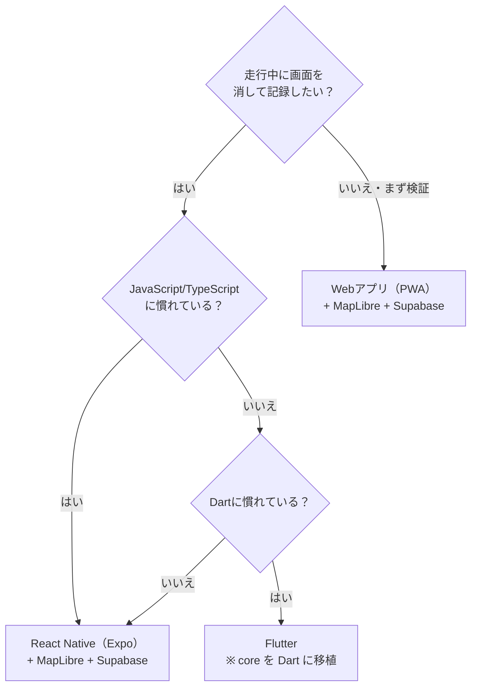

# 05 技術選定ガイド

どの技術で作るかは、開発する人が決められるように**未決**にしてあります。このページは判断材料です。

`core/`（中核ロジック）と `db/`（データベース）はどの選択肢でもそのまま使えるように作ってあります。

> 料金・規約・対応状況は変わります。ここに書いたことは2026年11月時点の一般的な情報なので、決める前に各公式サイトで確認してください。

---

## 1. アプリの形

ミチノートで一番効くのは**「画面を消して走っている間も GPS を記録し続けられるか」**です。

| | Webアプリ（PWA） | スマホアプリ（React Native / Expo） | スマホアプリ（Flutter） | ネイティブ（Swift / Kotlin） |
|---|---|---|---|---|
| 画面を消しての記録 | **iPhoneでは難しい**（ブラウザがバックグラウンドで位置を取れない） | できる | できる | できる |
| iOS と Android を1つのコードで | ○ | ○ | ○ | ×（2つ作る） |
| `core/`（TypeScript）をそのまま使う | ○ | ○ | ×（Dartに移植が必要） | ×（移植が必要） |
| 公開までの手間 | URLを配るだけ | ストア審査あり | ストア審査あり | ストア審査あり |
| 年間の固定費 | ほぼなし | Apple Developer Program（年額）、Google Play（初回登録料） | 同左 | 同左 |
| 向いている人 | Web開発に慣れている | Web/JavaScriptに慣れている | Dartに慣れている | 各OSの開発に慣れている |

### おすすめ

- **本番は React Native（Expo）を第一候補に。** 走行中の記録が中心のアプリなので、バックグラウンドで記録できることが大事です。`core/` も TypeScript なのでそのまま使えます。Expo でバックグラウンドの位置情報を使う場合は、Expo Go ではなく開発ビルド（development build）が必要になる点に注意してください。
- **企画の検証だけならPWAも選択肢。** 「画面を点けたまま、スマホをホルダーに固定して記録する」と割り切れば、Webだけで早く試せます。あとからスマホアプリに移るときも `core/` と `db/` は使い回せます。

## 2. 地図

| 部品 | 候補 | メモ |
|---|---|---|
| 地図の描画 | MapLibre GL（Web: `maplibre-gl`、RN: `@maplibre/maplibre-react-native`） | オープンソース。白地図のような独自スタイルを作りやすい |
| | Mapbox | 高機能・有料枠あり。独自スタイルも作りやすい |
| | Google Maps | 見慣れた地図。独自スタイルの自由度は比較的低い |
| 地図タイル（ナビ地図） | MapTiler、Stadia Maps などのタイル配信サービス | アプリから OpenStreetMap 公式のタイルサーバーを大量に使うことは利用方針で認められていないので、配信サービスを使うか自前で配信する |
| | Protomaps（PMTiles）で自前配信 | 1ファイルを置くだけで配信できる。費用を抑えやすい |
| 白地図 | 海岸線・湖・県境だけのスタイルを自作 | 試作品の見た目が目標 |

## 3. 走った道の判定（マップマッチング）

`core` の `matchEdges` は、依存なしで動く簡易版です。並行する道や立体交差では誤判定することがあるので、本番では次のいずれかに置き換えることを推奨します。戻り値（区間 ID の配列）の形を変えなければ、ほかのコードはそのまま動きます。

| 候補 | 種類 | メモ |
|---|---|---|
| Valhalla（`trace_attributes` / `trace_route`） | オープンソース、自前で動かす | OSMの道路IDと対応を取りやすい |
| OSRM（`match` サービス） | オープンソース、自前で動かす | 高速 |
| Mapbox Map Matching API | 有料API | 運用の手間が少ない |

## 4. 道路データ

| 候補 | メモ |
|---|---|
| OpenStreetMap | 無料。ライセンス（ODbL）に従い、地図上での出典表示が必要。加工したデータベースを公開・配布する場合は同じライセンスでの共有が求められることがある |
| 有料の道路データ・交通規制データ | 二輪規制や通行止めの網羅性・鮮度を重視するなら検討。費用と利用条件を確認 |

**二輪規制の情報をどこまで正確に持てるかは、提案機能の安全性に直結します。** `docs/08` の最重要の未決事項です。

## 5. バックエンド

| 候補 | メモ |
|---|---|
| **Supabase（推奨）** | PostgreSQL + PostGIS + 認証 + ストレージ + 行レベルセキュリティが揃う。`db/schema.sql` をそのまま流せる |
| Firebase | 導入が簡単。ただし位置の検索（範囲・線の処理）は苦手で、`schema.sql` の考え方を移植する必要がある |
| 自前のサーバー（Node.js など）+ PostgreSQL | 自由度が高い。運用の手間がかかる |

ルート提案の計算は、最初は端末側（`core` の `suggestRoutes`）で十分です。地域が広くなったらサーバー側に移します。

## 6. その他の部品

| 用途 | 候補 |
|---|---|
| 写真のEXIF読み取り・削除 | Web: `exifr` など / RN: `expo-image-picker` の EXIF 取得＋再エンコード |
| プッシュ通知 | Expo Notifications、Firebase Cloud Messaging |
| アルバム動画（段階3） | 端末で描画して書き出す、またはサーバーで生成 |
| エラー監視 | Sentry など |

## 7. 決め方の目安

